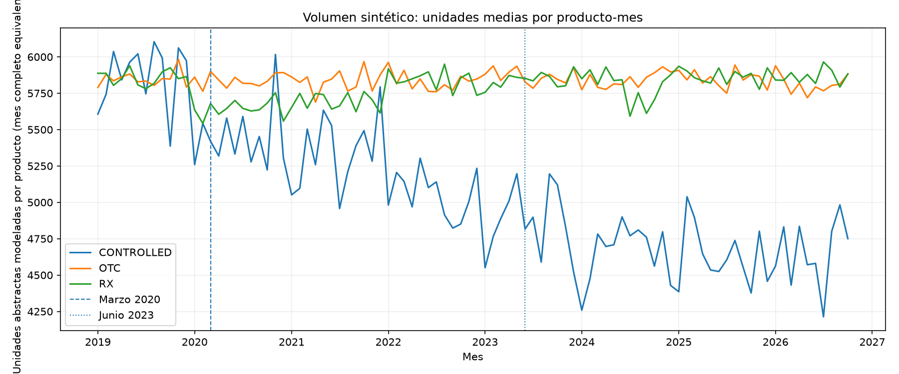
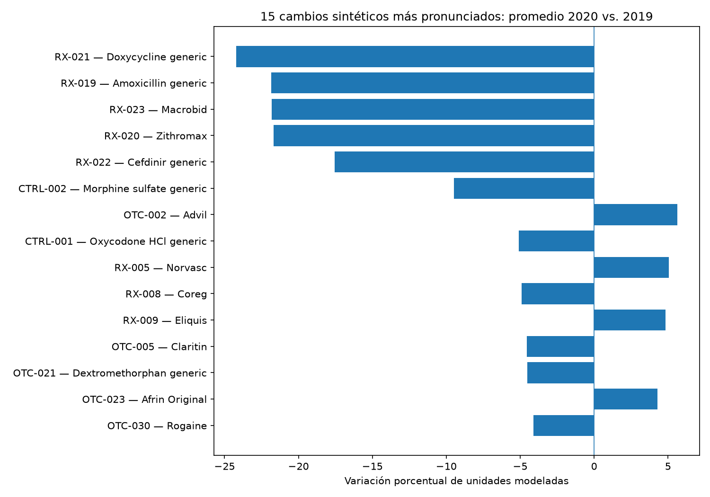
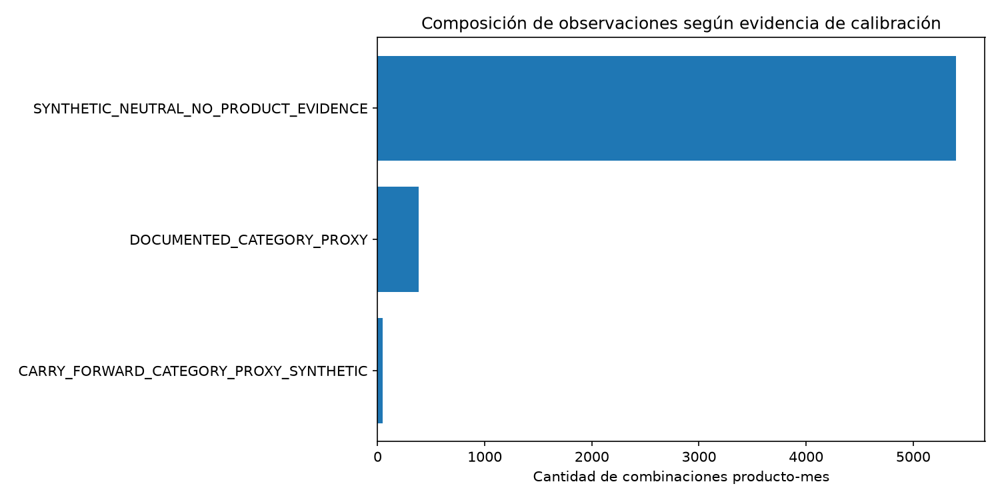

# Pharmaceutical Retail Sales USA — Python, pandas y análisis temporal

Proyecto reproducible de generación sintética, ingeniería de datos y EDA para **62 medicamentos** en el mercado minorista de referencia de EE. UU. (enero 2019–19 octubre 2026).

**Advertencia científica:** NO son ventas reales, totales nacionales, consumo clínico individual ni estimaciones con representatividad estadística. 5,850 unidades mensuales por producto son una referencia **artificial** del generador. Algunas tendencias proceden de proxies de categoría (opioides y antibióticos); el resto incluye supuestos neutros y variación sintética. No se pueden atribuir causalmente diferencias a COVID-19.

## Estructura

```text
pharma_retail_ml_project/
├── scripts/
│   ├── generador_ventas_farmaceuticas_usa.py
│   ├── unificar_datasets.py
│   └── visualizar_resultados.py
├── docs/
│   └── MANDATO_DE_PROYECTO.md
├── data/
│   ├── raw/                 # salidas del generador (no se suben a Git)
│   └── processed/           # archivos unificados (no se suben a Git)
├── reports/
│   └── figures/             # gráficos y métricas versionables
├── requirements.txt
└── .gitignore
```

## Inicio rápido

### 1. Crear un entorno

```bash
python -m venv .venv
```

Activar en Windows PowerShell: `.venv\Scripts\Activate.ps1`; en macOS/Linux: `source .venv/bin/activate`.

```bash
python -m pip install -r requirements.txt
```

### 2. Generar los archivos de origen

```bash
python scripts/generador_ventas_farmaceuticas_usa.py --output-dir data/raw
```

Puedes reducir el número de eventos para pruebas (no las unidades modeladas):

```bash
python scripts/generador_ventas_farmaceuticas_usa.py --output-dir data/raw --base-records-per-month 200
```

### 3. Unificar y validar con pandas

```bash
python scripts/unificar_datasets.py --input-dir data/raw --output-dir data/processed
```

**Principal:** `data/processed/dataset_unificado_mensual.csv` — 1 fila por producto-mes (5,828). Contiene medidas modeladas, categorías, medicamento, calibración, fuentes, QA y metadatos escalares del manifiesto.

**Complementario:** `data/processed/dataset_transaccional_enriquecido.csv` — 1 fila por evento sintético, con el ID de cada observación. No contiene columnas aditivas mensuales para evitar doble conteo.

**Auditoría:** `data/processed/auditoria_manifest_mensual.csv`, `resumen_validaciones.json` y copia íntegra de `metadata_manifest.json`.

**Nota:** `calibration_overrides_template.csv` es una plantilla vacía para introducir calibraciones adicionales y **no** se concatena al dataset de ventas.

### 4. Crear gráficos y CSV de indicadores

```bash
python scripts/visualizar_resultados.py --input data/processed/dataset_unificado_mensual.csv --output-dir reports/figures
```

Genera tres PNG, una tabla de indicadores por año y categoría y una tabla de diferencias entre 2020 y 2019.

## Ejemplo de análisis con pandas

```python
import pandas as pd

df = pd.read_csv("data/processed/dataset_unificado_mensual.csv", parse_dates=["month"])
print(df.shape)
print(df[["month", "product_name", "modeled_units_month", "calibration_level"]].head())

# Comparación de meses COMPLETOS y medias por producto, sin extrapolar a EE. UU.
completos = df.loc[df["is_partial_month"].eq(0)]
resultado = (completos.groupby(["year", "sale_category"], as_index=False)
             .agg(media_unidades_modeladas=("modeled_units_month", "mean")))
print(resultado)
```

## ¿Por qué no mezclar todo en una única tabla por transacción?

`pharma_monthly_sales.csv` ya tiene `modeled_units_month` por producto-mes. Si se une a cada evento de `pharma_retail_sales.csv` y luego se suma, ese valor aparecería repetido N veces. Por ello el dataset principal es **mensual**; el transaccional es otra perspectiva, no una segunda fuente de ventas independientes.

`modeled_units_contribution` es una distribución matemática del volumen modelado entre eventos ficticios, **NO un peso muestral inferencial**. Las unidades comerciales son abstractas y no constituyen tabletas, dosis ni pacientes comparables.

## Publicación en GitHub

Crea un repositorio vacío desde <https://github.com/new>, sin README ni gitignore de GitHub. Abre la terminal en esta carpeta:

```bash
git init
git add .
git commit -m "Initial commit: pharma retail synthetic data project"
git branch -M main
git remote add origin https://github.com/TU_USUARIO/pharma-retail-usa-ml.git
git push -u origin main
```

Verifica luego que aparezcan los archivos. La autenticación por HTTPS requerirá las opciones admitidas por GitHub; no se permiten contraseñas de cuenta convencionales para `git push` por HTTPS.

Más detalles y criterios de evaluación: [Mandato del proyecto](docs/MANDATO_DE_PROYECTO.md).

## Fuentes y límites de la calibración original

- CDC, opioides, agregado anual: https://www.cdc.gov/overdose-prevention/data-research/facts-stats/us-dispensing-rate-maps.html
- Estudio de antibióticos ambulatorios: https://pmc.ncbi.nlm.nih.gov/articles/PMC11526179/
- FDA NDC como fuente para futuras comprobaciones: https://open.fda.gov/apis/drug/ndc/
- El catálogo es una preselección: no incluye validación individual definitiva de NDC/fechas de comercialización.

El manifiesto explica exactamente los parámetros y las limitaciones de cada ejecución.

## Comprobar integridad con tests

Después de generar y unificar los datos:

```bash
python -m unittest discover -s tests -v
```

## Vista previa de los gráficos







> **Lectura responsable:** las gráficas describen una ejecución sintética; no son estadísticas oficiales por producto.
